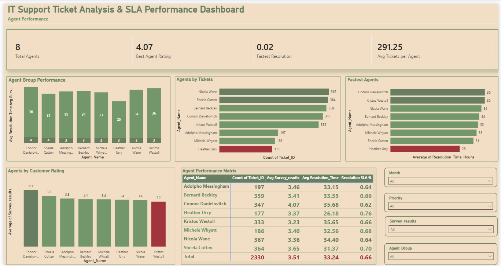
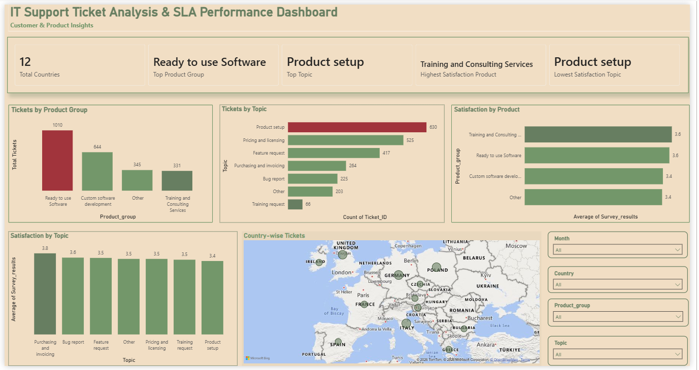

# IT Support Ticket Analysis & SLA Performance

Analysis of 2,330 IT support tickets (January–December 2023) to measure SLA performance, find where resolution commitments are missed, and turn the findings into practical recommendations.

## Headline Result

> First responses meet SLA **86.7%** of the time, but only **66.4%** of tickets are **resolved** within SLA, so roughly **1 in 3 tickets** misses its resolution commitment.

| Metric | Result |
|---|---|
| Total tickets | 2,330 |
| Countries | 12 |
| Agents | 8 |
| First Response SLA | 86.7% |
| Resolution SLA | 66.4% |
| Avg. resolution time | ~33.2 hrs |
| Avg. satisfaction | 3.51 / 5 (1,173 survey responses) |

## Business Questions

1. Are SLA commitments being met, and where are they missed?
2. How does ticket demand vary by weekday and month?
3. How do agents and product lines compare on volume, speed and customer satisfaction?

## How It Was Built

1. **Clean the data (Python):** raw timestamps were stored as text, so six timestamp fields were converted to datetime to allow reliable duration calculations. Missing first-response, resolution and close times were left as nulls, not imputed.
2. **Engineer features (Python):** calendar fields (year, month, weekday, hour), weekday/weekend, business hours (9:00–18:00) vs. after hours, response time, resolution time, close duration, and response delay against the SLA target.
3. **Explore the data (Python):** ticket volume by month and weekday, composition by product, topic and channel, and SLA compliance.
4. **Answer targeted questions (SQL, MySQL):** window functions (`RANK`, `ROW_NUMBER`, `LAG`) to rank agents, find the top agent per support group, and measure month-over-month ticket change.
5. **Build the dashboard (Power BI, DAX):** a 4-page filterable dashboard covering executive overview, agent performance, customer and product insights, and operations and SLA performance.

## The Dataset

2,330 tickets and 22 columns, created January–December 2023, across 8 agents and 12 countries.

- **Ticket attributes:** Priority, Source (channel), Topic, Product group, Support Level, Country
- **Ownership:** Agent Group, Agent Name
- **Timestamps:** Created, Expected SLA (first response and resolution), actual First response, Resolution, Close
- **SLA flags:** SLA for first response, SLA for resolution (Within SLA / SLA Violated)
- **Outcomes:** Agent interactions, customer satisfaction survey score

**Ticket status at extraction:** 1,173 closed, 739 resolved, 400 in progress, 18 open. The 18 open tickets have no first response yet. Satisfaction scores exist only for 1,173 tickets.

## Key Findings

- **Resolution, not first response, is the weak point.** 86.7% of tickets meet the first-response target versus 66.4% for resolution.
- **Resolution misses are spread broadly, not concentrated in one segment.** Violation rates sit between 30% and 37% across every priority and product group:

  | Segment | Violation rate |
  |---|---|
  | Custom software development | 37.4% (241 / 644) |
  | Other | 33.6% (116 / 345) |
  | Ready to use software | 31.9% (322 / 1,010) |
  | Training and consulting | 31.4% (104 / 331) |
  | Priority: Medium / Low / High | 35.0% / 33.9% / 30.3% |

- **Ready to Use Software is the largest contributor by volume:** 43% of tickets and 41% of violations, in line with its size. Custom software development has the highest violation rate.
- **Medium-priority tickets have the highest violation rate (35.0%) and the longest average resolution time (34.9 hrs)**, versus High (30.3%, 33.2 hrs) and Low (33.9%, 32.3 hrs). The differences are modest and worth reviewing rather than conclusive.
- **Agent performance varies across metrics:**

  | Agent | Tickets | Avg. satisfaction | Avg. resolution (hrs) | Resolution SLA |
  |---|---|---|---|---|
  | Nicola Wane | 367 | 3.36 | 34.40 | 64% |
  | Sheela Cutten | 364 | 3.65 | 31.37 | 70% |
  | Bernard Beckley | 359 | 3.41 | 33.55 | 66% |
  | Connor Danielovitch | 347 | 4.07 | 35.68 | 62% |
  | Kristos Westoll | 333 | 3.23 | 35.65 | 66% |
  | Adolpho Messingham | 197 | 3.46 | 33.15 | 64% |
  | Michele Whyatt | 186 | 3.40 | 32.56 | 68% |
  | Heather Urry | 177 | 3.37 | 26.18 | 76% |

  Connor has the highest satisfaction but the lowest resolution SLA rate. Heather is the fastest with the best SLA rate, on the lowest volume. Sheela is consistently strong on all three measures.
- **Demand by weekday and month:** Wednesday (439) and Monday (410) are the busiest weekdays. Weekend tickets are about 15% of the total, and weekend days average roughly 56% fewer tickets than weekdays. Monthly volume peaked in January (224), May (219) and November (213), and was lowest in February (159).
- **Email is the largest channel:** 1,234 tickets (53%), followed by Chat (850) and Phone (246).
- **Product Setup is both the highest-volume topic (630 tickets) and the lowest-rated (3.4 / 5).** Topic averages range only from about 3.4 to 3.8.

## Recommendations

1. **Make Resolution SLA the primary metric for the next improvement cycle:** it has the larger gap (33.6% violated).
2. **Treat the misses as a process-level issue.** Since every segment is at 30–37%, look at capacity, escalation and hand-offs, and whether the resolution targets are realistic, instead of fixing a single segment. Start with Custom software development (highest rate) and Ready to use software (largest volume).
3. **Review Medium-priority ticket handling**, including how queues are prioritised, to find out why it trails High priority.
4. **Use strong performers as coaching references:** Heather Urry (speed), Sheela Cutten (balanced speed, SLA and satisfaction) and Connor Danielovitch (satisfaction). Check differences in agent group and ticket mix first.
5. **Review staffing against weekday demand.** Weekend volume is much lower; confirm the Monday/Wednesday and monthly peaks with more than one year of data before changing coverage.
6. **Improve Product Setup onboarding content**, since it has the highest volume and the lowest satisfaction.
7. **Analyse response time and SLA by channel before changing Email workflows.** This was not covered in this project.

## Dashboard

4-page interactive Power BI dashboard with slicers (Month, Priority, Source, Product group, Country, Topic, Agent group, depending on the page).

## Reports in This Repo

- [Detailed Technical Report](IT_Support_Ticket_Analysis_Report.pdf): full methodology
- [Executive Summary](IT_Support_Ticket_Executive_Summary.pdf): stakeholder version
- [Stakeholder Slide Deck](IT_Support_Ticket_Executive_Summary.pptx)

## Limitations

- **One year of data (2023):** peaks and weekday patterns are descriptive; seasonality cannot be separated from one-off variation.
- **Unresolved tickets:** the 66.4% resolution SLA is calculated over all 2,330 tickets, including the 418 still open or in progress at extraction. Their SLA status comes from the dataset's own flag.
- **Satisfaction scores** exist for 1,173 tickets only.
- **Agent comparisons** are not adjusted for agent group, priority or product mix, and ticket volumes differ by almost 2x between agents.
- **Priority and product differences** are modest and were not tested for statistical significance.
- **Channel-level performance** (response time and SLA by channel) was not analysed.

## About

**Gayatri Kasbekar**
📧 gayatrikasbekar1311@gmail.com &nbsp;|&nbsp; 🔗 [GitHub: Gayatrik04](https://github.com/Gayatrik04) &nbsp;|&nbsp; 🔗 [LinkdeIn: Gayatri Kasbekar](https://www.linkedin.com/in/gayatri-kasbekar-674a883a3/)
