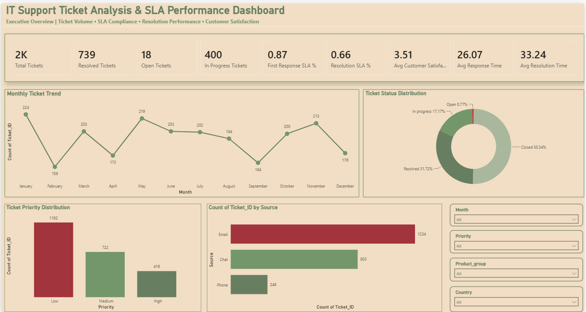
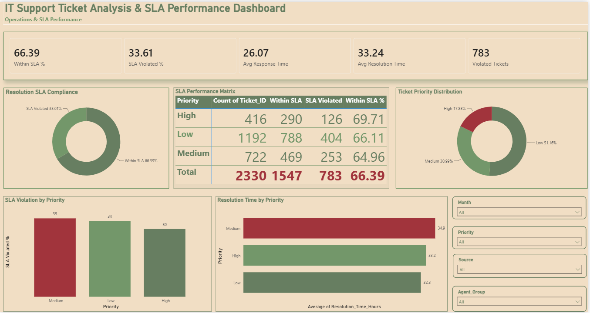

# IT_Support_Ticket_and_SLA_Performance

# IT Support Ticket Analysis & SLA Performance

Analysis of 2,330 IT support tickets to find out where we're meeting SLA commitments — and where we're not — and to turn that into a clear action plan.

## Why This Project Exists

Support teams generate huge volumes of ticket data, but most of it never turns into a decision. Without structured analysis, SLA breaches get discovered reactively — through customer complaints — instead of proactively; staffing doesn't get aligned to real demand; and agent coaching or product fixes don't get prioritized by actual impact.

This project was built to close that gap: take a year of raw ticket logs and turn them into three concrete answers —
1. Are we meeting our SLA commitments, and where exactly are we falling short?
2. Is ticket demand predictable enough to staff against?
3. Which agents and product lines are driving the best — and worst — outcomes?

## How It Was Built

1. **Clean the data (Python)** — raw timestamps were stored as text; converted six timestamp fields to proper datetime values so durations could be calculated reliably.
2. **Engineer features (Python)** — derived response time, resolution time, business-hours vs. after-hours, weekday/weekend, and an SLA-delay measure (actual first response vs. the SLA target) from the cleaned timestamps.
3. **Explore the data (Python)** — charted ticket volume by month/weekday, ticket composition by product/topic/channel, and SLA compliance rates.
4. **Answer targeted business questions (SQL)** — used window functions to rank agents by volume, find the top agent per support tier, and measure month-over-month ticket growth.
5. **Build the dashboard (Power BI)** — packaged everything into a 4-page, filterable executive dashboard so the findings stay usable beyond this one report.

## The Dataset

2,330 tickets, 8 agents, 12 countries, 12 months. Each ticket record includes:

- **Ticket attributes** — Priority, Source (channel), Topic, Product group, Support Level, Country
- **Ownership** — Agent Group, Agent Name
- **Timestamps** — Created, Expected SLA (first response & resolution), actual First response, Resolution, Close
- **Outcome data** — Agent interactions, customer satisfaction survey score

Not every ticket is "complete" — 18 tickets had no first response yet and 1,173 weren't yet closed at the time of extraction. Those gaps were left as-is rather than filled in, because a ticket that's genuinely still open shouldn't be counted as resolved.

## Headline Result

> We answer customers on time **87%** of the time, but only **resolve** tickets on time **66%** of the time — roughly **1 in 3 tickets** misses its resolution commitment.

| Metric | Result |
|---|---|
| Total tickets | 2,330 |
| Countries served | 12 |
| First Response SLA | 86.7% |
| Resolution SLA | 66.4% |
| Avg. satisfaction | 3.51 / 5 |

## Key Insights

- **Ready to Use Software drives outsized risk** — 43% of all tickets and 41% of all SLA violations trace back to this one product line.
- **Medium-priority tickets are the weak point, not High-priority ones** — 35% violation rate and 34.9-hr average resolution time, both worse than High-priority tickets (30% violation, 33.2 hrs).
- **Agent strengths don't overlap** — Nicola Wane handles the most tickets (367) but isn't top-rated; Connor Danielovitch has the highest satisfaction (4.07/5) but a below-average resolution SLA rate (62%); Heather Urry resolves fastest (26.2 hrs avg) with the best SLA rate (76%) despite the lowest ticket volume.
- **Demand follows a clear rhythm** — Wednesday and Monday are consistently the busiest weekdays; weekends run ~60% lighter; January, May, and November are recurring monthly peaks.
- **Email is the busiest and likely the slowest channel** — 53% of tickets arrive by email, and it's a probable driver of first-response SLA misses.
- **Product Setup is a satisfaction problem, not just a volume problem** — it's the highest-volume topic (630 tickets) and the lowest-satisfaction one (3.4/5), and the two are connected.
- **First response and resolution tell different stories** — 86.7% first-response compliance vs. 66.4% resolution compliance shows the team is fast to engage but slower to follow through.

## Business Impact

- **Resolution SLA, not First Response SLA, is the real risk.** Customers are heard quickly, but nearly a third of promises to resolve their issue aren't kept — that's the metric most likely to erode trust and retention.
- **The gap is concentrated, not diffuse.** It's traceable to one product line, one priority tier, and one channel — which means it's fixable with targeted effort rather than a costly operation-wide overhaul.
- **Demand is predictable**, so staffing costs can be optimized rather than spread evenly across days that don't need equal coverage.
- **Coaching, not hiring, is the fastest lever on agent performance** — the team already has agents excelling at speed and at satisfaction; the gap is spreading those strengths across the team.

## Recommendations

1. **Make Resolution SLA the primary metric for the next improvement cycle**, not First Response SLA — it has the larger gap (33.6% violation) and the larger impact on customer trust.
2. **Run a focused SLA-improvement initiative on Ready to Use Software.** It accounts for 43% of ticket volume and 41% of all SLA violations — even a modest improvement here moves the company-wide number meaningfully.
3. **Investigate Medium-priority ticket handling specifically.** Its 35% violation rate and 34.9-hr average resolution time exceed High-priority tickets, which is counter-intuitive — likely a queue-prioritization rule worth auditing.
4. **Use top performers as internal coaching benchmarks**: pair Heather Urry's resolution speed (26.2 hrs avg, 76% SLA) with Connor Danielovitch's customer-satisfaction approach (4.07/5) as a combined playbook for the rest of the team.
5. **Align staffing with actual demand.** Add coverage for Monday/Wednesday and the January/May/November peaks; consider redeploying weekend headcount to weekdays given the ~60% weekend volume drop.
6. **Fix Product Setup friction.** It's simultaneously the highest-volume topic and the lowest-satisfaction one — improved onboarding docs or in-product guidance should reduce both ticket volume and dissatisfaction at once.
7. **Review Email response workflows.** It's the busiest channel (53% of tickets) and the most likely driver of first-response SLA misses.

## Dashboard

4-page interactive Power BI dashboard — Executive Overview, Agent Performance, Customer & Product Insights, Operations & SLA Performance — filterable by Month, Priority, Source, Product, Country, Topic, and Agent Group.

## Reports in This Repo

- 📄 [Detailed Technical Report](IT_Support_Ticket_Analysis_&_SLA_Performance_Dashboard/IT_Support_Ticket_Analysis_Report.pdf) — full methodology
- 📊 [Executive Summary](IT_Support_Ticket_Analysis_&_SLA_Performance_Dashboard/IT_Support_Ticket_Executive_Summary.pdf) — stakeholder version
- 🖥️ [Stakeholder Slide Deck](IT_Support_Ticket_Analysis_&_SLA_Performance_Dashboard/IT_Support_Ticket_Executive_Summary (1).pptx)

> Update these paths to match your repo's actual folder layout before pushing.

## About

**Gayatri Kasbekar** 
📧 gayatrikasbekar1311@gmail.com &nbsp;|&nbsp; 🔗 [GitHub — Gayatrik04](https://github.com/Gayatrik04)
